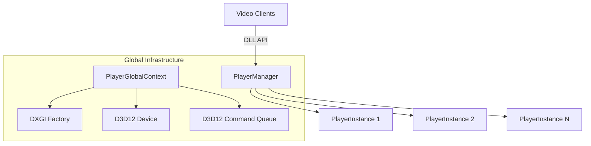
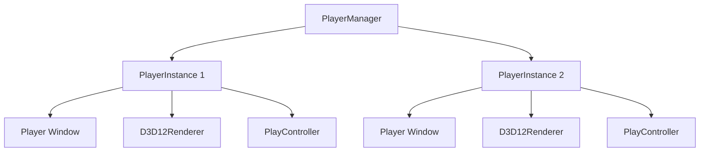
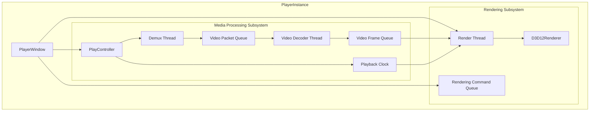
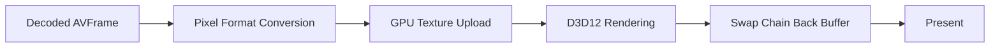
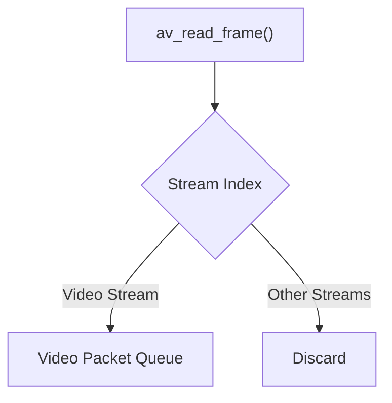
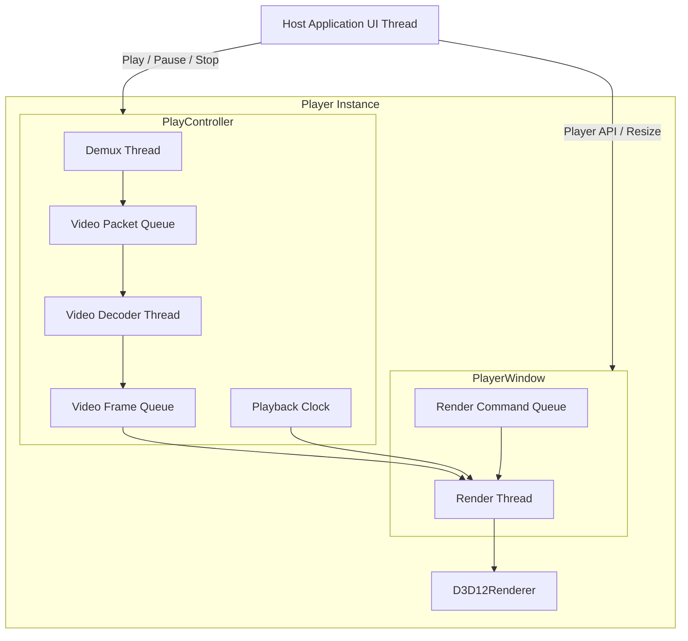
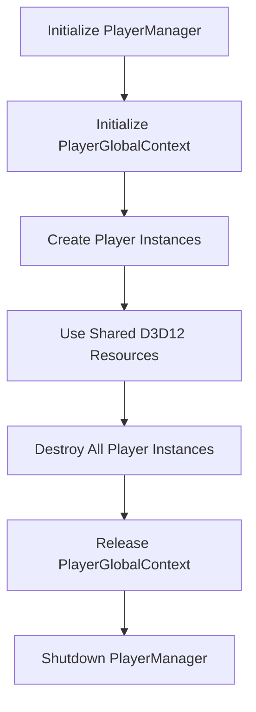

# D3D12 + FFmpeg Video Player
## Software Architecture and Design Document

**Version:** 2.0  
**Language:** C++20  
**Platform:** Windows  
**Graphics API:** Direct3D 12  
**Media Framework:** FFmpeg  
**Window Management:** Windows API

---

# 1. Introduction

## 1.1 Purpose

This document describes the software architecture and design of a multi-instance video player implemented using FFmpeg and Direct3D 12.

The player is designed to support local video files and live RTSP streams. It provides an embeddable playback window that can be integrated into an existing Windows application through a DLL interface.

The architecture is designed around three main concerns:

- Global infrastructure and shared graphics resources.
- Player instance management and lifecycle.
- Per-instance media processing and video rendering.

The implementation intentionally keeps the number of major classes small while maintaining clear separation of responsibilities.

The first version focuses exclusively on video playback. Audio decoding and audio output are outside the scope of this version.

## 1.2 Design Goals

The primary design goals are:

- Support multiple independent player instances.
- Share global D3D12 resources across all player instances.
- Separate media decoding from graphics rendering.
- Support asynchronous playback operations.
- Support local file playback and live RTSP streaming.
- Implement reliable video frame scheduling.
- Handle window resizing and rendering lifecycle changes.
- Provide predictable thread ownership and resource management.
- Minimize unnecessary architectural complexity.

## 1.3 Technology Stack

| Component | Technology |
|---|---|
| Programming Language | C++20 |
| Multimedia Framework | FFmpeg |
| Video Rendering | Direct3D 12 |
| Graphics Infrastructure | DXGI |
| Window Management | Windows API |
| Thread Management | std::jthread |
| Thread Synchronization | std::mutex, std::condition_variable |
| Inter-thread Communication | Thread-safe queues |

---

# 2. Global Architecture

## 2.1 Overview

The global architecture consists of two classes:

1. **PlayerManager**
2. **PlayerGlobalContext**

PlayerManager is the central entry point for managing player instances.

PlayerGlobalContext manages graphics resources shared by all player instances.

These components are initialized once and remain available throughout the lifetime of the player subsystem.

The global architecture is independent of individual playback sessions.

## 2.2 Architecture Diagram



## 2.3 PlayerManager

### 2.3.1 Responsibilities

PlayerManager manages the lifecycle of all player instances.

It is the entry point through which the DLL creates and destroys player instances.

Responsibilities:

- Initialize and shut down the player subsystem.
- Own and manage PlayerGlobalContext.
- Create player instances.
- Maintain a collection of active player instances.
- Locate player instances using their instance identifiers.
- Destroy individual player instances.
- Ensure all player instances are destroyed before global resources are released.

PlayerManager does not perform media decoding or graphics rendering.

### 2.3.2 Class Structure

```cpp
class PlayerManager
{
public:
    HRESULT Initialize();
    void Shutdown();

    HRESULT CreatePlayerInstance(
        HWND parentWindow,
        long* playerInstance);

    HRESULT DestroyPlayerInstance(
        long playerInstance);

private:
    std::mutex m_mutex;

    std::unordered_map<
        long,
        std::shared_ptr<PlayerInstance>> m_instances;

    std::unique_ptr<PlayerGlobalContext> m_globalContext;
};
```

The class may be implemented as a process-wide singleton within the DLL.

The exported DLL functions forward requests to PlayerManager.

### 2.3.3 Instance Management

PlayerManager maintains a mapping between player instance identifiers and PlayerInstance objects.

Each instance identifier uniquely identifies a player instance during its lifetime.

When a player instance is created:

1. Allocate a new instance identifier.
2. Create a PlayerInstance.
3. Initialize the instance using the shared PlayerGlobalContext.
4. Register the instance in the instance collection.
5. Return the identifier to the host application.

When an instance is destroyed:

1. Locate the corresponding PlayerInstance.
2. Prevent new operations from being submitted to the instance.
3. Shut down the instance.
4. Remove it from the instance collection.
5. Release the instance resources.

The manager mutex should protect the instance collection rather than being held throughout potentially time-consuming initialization or shutdown operations.

Operations should obtain a stable reference to the target instance before releasing the manager mutex.

### 2.3.4 Global Lifecycle

PlayerManager controls the lifetime of PlayerGlobalContext.

Initialization order:

1. Initialize PlayerGlobalContext.
2. Make global graphics resources available.
3. Allow player instances to be created.

Shutdown order:

1. Prevent creation of new player instances.
2. Destroy all existing player instances.
3. Release PlayerGlobalContext.
4. Complete subsystem shutdown.

This guarantees that shared graphics resources remain valid while any player instance is using them.

---

## 2.4 PlayerGlobalContext

### 2.4.1 Responsibilities

PlayerGlobalContext owns the graphics resources shared by all player instances.

Instead of creating an independent D3D12 device for every player, all D3D12Renderer instances use the same device and graphics command queue.

Responsibilities:

- Create and manage the DXGI factory.
- Enumerate and select the GPU adapter.
- Create the D3D12 device.
- Create the shared graphics command queue.
- Provide access to shared graphics resources.
- Release global graphics resources during shutdown.

PlayerGlobalContext does not own individual swap chains, render targets, or per-instance rendering resources.

### 2.4.2 Class Structure

```cpp
class PlayerGlobalContext
{
public:
    HRESULT Initialize();
    void Shutdown();

    IDXGIFactory6* GetFactory() const;
    IDXGIAdapter1* GetAdapter() const;
    ID3D12Device* GetDevice() const;
    ID3D12CommandQueue* GetCommandQueue() const;

private:
    HRESULT CreateFactory();
    HRESULT SelectAdapter();
    HRESULT CreateDevice();
    HRESULT CreateCommandQueue();

private:
    ComPtr<IDXGIFactory6> m_factory;
    ComPtr<IDXGIAdapter1> m_adapter;
    ComPtr<ID3D12Device> m_device;
    ComPtr<ID3D12CommandQueue> m_commandQueue;
};
```

### 2.4.3 Shared Graphics Resources

The following resources are shared across player instances:

| Resource | Ownership | Description |
|---|---|---|
| DXGI Factory | PlayerGlobalContext | Enumerates adapters and creates swap chains |
| GPU Adapter | PlayerGlobalContext | Selected hardware graphics adapter |
| D3D12 Device | PlayerGlobalContext | Shared graphics device |
| Graphics Command Queue | PlayerGlobalContext | Shared graphics command execution queue |

The selected GPU adapter should be a hardware adapter that supports the required D3D12 feature level.

Software adapters should be excluded unless software rendering is explicitly required.

### 2.4.4 Resource Sharing Strategy

Each D3D12Renderer obtains references to the shared resources during initialization.

For example:

```cpp
HRESULT D3D12Renderer::Initialize(
    HWND hwnd,
    PlayerGlobalContext& globalContext)
{
    m_factory = globalContext.GetFactory();
    m_device = globalContext.GetDevice();
    m_commandQueue = globalContext.GetCommandQueue();

    // Initialize instance-specific resources.

    return S_OK;
}
```

The renderer should retain ComPtr references to shared COM resources so their lifetime is properly managed.

The global context must remain alive until all renderers have released their references and shut down.

Multiple renderers can submit commands to the shared graphics command queue. GPU execution and resource reuse must be synchronized appropriately.

---

# 3. Instance Management

## 3.1 Overview

Each player instance represents an independent video playback window.

PlayerManager creates and manages PlayerInstance objects.

PlayerInstance is responsible for coordinating the lifecycle of its own playback and rendering components.

Each instance contains three primary components:

- PlayerWindow
- D3D12Renderer
- PlayController

Each instance has its own window, rendering thread, media decoding pipeline, queues, and playback state.

## 3.2 PlayerInstance

### 3.2.1 Responsibilities

PlayerInstance represents a single logical player.

It owns the three primary components and coordinates their initialization and shutdown.

Responsibilities:

- Own PlayerWindow.
- Own D3D12Renderer.
- Own PlayController.
- Initialize the components in the correct order.
- Coordinate playback and rendering lifecycle.
- Ensure all instance resources are released during shutdown.

PlayerInstance does not implement FFmpeg decoding or D3D12 rendering itself.

### 3.2.2 Class Structure

```cpp
class PlayerInstance
{
public:
    HRESULT Initialize(
        HWND parentWindow,
        PlayerGlobalContext& globalContext);

    HRESULT Play(const std::wstring& url);
    HRESULT Pause();
    HRESULT Resume();
    HRESULT Stop();

    HRESULT Resize(UINT width, UINT height);

    void Shutdown();

private:
    std::unique_ptr<PlayerWindow> m_window;
    std::unique_ptr<D3D12Renderer> m_renderer;
    std::unique_ptr<PlayController> m_playController;
};
```

The components are owned exclusively by their PlayerInstance.

The actual initialization and coordination methods can be adjusted as implementation details become clearer.

### 3.2.3 Instance Initialization

A typical initialization sequence is:

1. Create PlayerWindow and its child HWND.
2. Create D3D12Renderer.
3. Initialize D3D12Renderer using PlayerGlobalContext.
4. Create PlayController.
5. Initialize PlayController.
6. Connect the components.
7. Start the rendering thread.

The swap chain may not be created during initialization if the playback window has zero dimensions.

Swap-chain creation is deferred until a valid client size becomes available.

### 3.2.4 Instance Shutdown

The shutdown sequence must respect the dependencies between components.

Recommended sequence:

1. Prevent new playback operations.
2. Stop PlayController.
3. Wait for all media processing threads to exit.
4. Stop the rendering thread.
5. Wait for the rendering thread to exit.
6. Shut down D3D12Renderer.
7. Destroy PlayerWindow.
8. Release the remaining instance resources.

The rendering thread must exit before D3D12Renderer is destroyed.

The shared PlayerGlobalContext remains alive because other player instances may still be using it.

## 3.3 Instance Architecture Diagram



The diagram illustrates that PlayerWindow, D3D12Renderer, and PlayController are independent within each player instance.

D3D12Renderer accesses the shared graphics infrastructure through PlayerGlobalContext.

---

# 4. Per-Instance Architecture

## 4.1 Overview

The per-instance architecture consists of three primary functional components:

1. PlayerWindow
2. D3D12Renderer
3. PlayController

Their responsibilities are deliberately separated.

PlayerWindow coordinates window management and rendering execution.

D3D12Renderer handles all graphics operations.

PlayController handles all media processing operations.

The components communicate through well-defined interfaces and thread-safe data structures.

## 4.2 Architecture Diagram



## 4.3 PlayerWindow

### 4.3.1 Responsibilities

PlayerWindow manages the native playback window and coordinates rendering execution.

Responsibilities:

- Create and manage the child HWND.
- Handle window messages.
- Own the rendering thread.
- Maintain the rendering command queue.
- Process rendering-related commands.
- Retrieve decoded video frames from PlayController.
- Synchronize video frame presentation with the playback clock.
- Coordinate rendering operations through D3D12Renderer.

PlayerWindow does not directly manage FFmpeg contexts or D3D12 resources.

### 4.3.2 Class Structure

```cpp
class PlayerWindow
{
public:
    HRESULT Initialize(HWND parentWindow);

    HRESULT Resize(UINT width, UINT height);

    void StartRendering();
    void StopRendering();

    void Shutdown();

private:
    void RenderThread(std::stop_token stopToken);

    void ProcessCommand(const RenderCommand& command);
    void ProcessPendingVideoFrames();

private:
    HWND m_hwnd = nullptr;

    D3D12Renderer* m_renderer = nullptr;
    PlayController* m_playController = nullptr;

    ThreadSafeQueue<RenderCommand> m_commandQueue;

    std::jthread m_renderThread;
};
```

The renderer and controller pointers are non-owning references. PlayerInstance owns their lifetimes.

### 4.3.3 Window Management

PlayerWindow creates a child window using CreateWindowExW.

The host application supplies the parent HWND when creating the player instance.

The child window is responsible for displaying video within the host application's playback area.

Relevant window messages include:

- WM_SIZE
- WM_PAINT
- WM_ERASEBKGND
- WM_DESTROY

WM_SIZE notifications are converted into rendering commands.

The window procedure must not directly perform swap-chain resizing or other D3D12 operations.

### 4.3.4 Rendering Thread

PlayerWindow owns one rendering thread per player instance.

The rendering thread is responsible for:

- Processing rendering commands.
- Checking rendering surface availability.
- Retrieving decoded video frames.
- Scheduling frame presentation.
- Calling D3D12Renderer to render frames.
- Presenting frames.

A conceptual rendering loop:

```cpp
void PlayerWindow::RenderThread(
    std::stop_token stopToken)
{
    while (!stopToken.stop_requested())
    {
        RenderCommand command;

        if (m_commandQueue.WaitPopFor(
                command,
                std::chrono::milliseconds(5),
                stopToken))
        {
            ProcessCommand(command);
        }

        ProcessPendingVideoFrames();
    }
}
```

The rendering thread should avoid unnecessary CPU consumption when no video frames are available.

Rendering operations must be skipped when the swap chain is not initialized or the window dimensions are invalid.

### 4.3.5 Rendering Command Queue

The command queue serializes rendering operations.

Typical commands include:

- Resize
- Clear
- Update rendering configuration
- Reconfigure rendering resources

Playback commands such as Play, Pause, Resume, and Stop are handled by PlayController and do not need to be routed through the rendering command queue.

The rendering thread is stopped using std::jthread and its stop token. A dedicated Shutdown command is not required.

---

## 4.4 D3D12Renderer

### 4.4.1 Responsibilities

D3D12Renderer encapsulates all Direct3D 12 functionality.

It receives decoded video frames and renders them into its associated playback window.

Responsibilities:

- Obtain shared graphics resources from PlayerGlobalContext.
- Create and manage the instance-specific swap chain.
- Create and manage back buffers.
- Manage descriptor heaps.
- Manage command allocators and command lists.
- Upload video frames to GPU resources.
- Perform pixel format conversion when required.
- Execute rendering commands.
- Present rendered frames.
- Handle swap-chain resizing.
- Synchronize GPU execution and resource reuse.

### 4.4.2 Class Structure

```cpp
class D3D12Renderer
{
public:
    HRESULT Initialize(
        HWND hwnd,
        PlayerGlobalContext& globalContext);

    HRESULT CreateSwapChain(
        HWND hwnd);

    HRESULT Resize(
        UINT width,
        UINT height);

    HRESULT RenderVideoFrame(
        const AVFrame* frame);

    void Shutdown();

private:
    HRESULT CreateCommandObjects();
    HRESULT CreateRenderTargets();
    HRESULT CreatePipelineState();
    HRESULT CreateVideoResources();

    void WaitForGpu();

private:
    ComPtr<IDXGIFactory6> m_factory;
    ComPtr<ID3D12Device> m_device;
    ComPtr<ID3D12CommandQueue> m_commandQueue;

    ComPtr<IDXGISwapChain3> m_swapChain;

    // Instance-specific D3D12 resources.
};
```

The shared factory, device, and command queue are obtained from PlayerGlobalContext.

All other rendering resources are owned by the individual renderer.

### 4.4.3 Shared and Instance-Specific Resources

| Resource | Ownership |
|---|---|
| DXGI Factory | PlayerGlobalContext |
| GPU Adapter | PlayerGlobalContext |
| D3D12 Device | PlayerGlobalContext |
| Graphics Command Queue | PlayerGlobalContext |
| Swap Chain | D3D12Renderer |
| Back Buffers | D3D12Renderer |
| RTV Descriptor Heap | D3D12Renderer |
| Command Allocators | D3D12Renderer |
| Graphics Command List | D3D12Renderer |
| Pipeline State Objects | D3D12Renderer |
| Video Textures | D3D12Renderer |
| Upload Buffers | D3D12Renderer |
| Rendering Fence | D3D12Renderer |

Each renderer maintains its own rendering state and GPU resource synchronization.

Although the graphics command queue is shared, each renderer must correctly synchronize its own command submission and resource lifetime.

### 4.4.4 Swap Chain Initialization

Swap-chain creation is deferred until the playback window has a valid non-zero client size.

The graphics device can be initialized independently of the swap chain.

The first valid resize notification triggers swap-chain creation.

The swap chain is created for the HWND associated with the corresponding PlayerWindow.

### 4.4.5 Resize Handling

Resize operations are executed on the rendering thread.

The procedure is:

1. Wait for GPU operations referencing existing back buffers to complete.
2. Release existing back-buffer references.
3. Call ResizeBuffers.
4. Retrieve the new back buffers.
5. Recreate render-target views.
6. Update viewport and scissor rectangles.

Zero-sized dimensions indicate a minimized or temporarily unavailable rendering surface.

The renderer should defer resizing until valid dimensions become available.

### 4.4.6 Video Rendering Pipeline

The renderer accepts decoded AVFrame objects from PlayController.

The rendering pipeline is:



For software-decoded frames, FFmpeg pixel format conversion facilities such as libswscale can be used.

For hardware-decoded frames, GPU resource interoperability and synchronization must be implemented explicitly.

The renderer must ensure that source frame memory remains valid until the upload operation has finished reading it.

GPU resource reuse must be protected by appropriate fence synchronization.

---

## 4.5 PlayController

### 4.5.1 Responsibilities

PlayController manages the entire FFmpeg media processing pipeline.

The first version only handles video streams.

Responsibilities:

- Open local files and RTSP streams.
- Initialize FFmpeg format and codec contexts.
- Demux compressed video packets.
- Decode video frames.
- Maintain video packet and frame queues.
- Manage playback state.
- Implement Play, Pause, Resume, and Stop.
- Maintain the playback clock.
- Support video frame scheduling.
- Handle end-of-stream conditions.
- Handle network interruptions and media errors where applicable.

Audio decoding and audio output are not implemented in this version.

### 4.5.2 Class Structure

```cpp
class PlayController
{
public:
    HRESULT Initialize();

    HRESULT Play(const std::wstring& url);
    HRESULT Pause();
    HRESULT Resume();
    HRESULT Stop();

    bool TryGetVideoFrame(
        VideoFrame& frame);

    double GetMasterClock() const;

    void Shutdown();

private:
    void DemuxThread(std::stop_token stopToken);
    void VideoDecoderThread(std::stop_token stopToken);

private:
    ThreadSafeQueue<Packet> m_videoPacketQueue;
    ThreadSafeQueue<VideoFrame> m_videoFrameQueue;

    std::jthread m_demuxThread;
    std::jthread m_videoDecoderThread;

    // FFmpeg resources and playback state.
};
```

The actual implementation should use RAII wrappers for FFmpeg resources and appropriate ownership semantics for AVPacket and AVFrame.

### 4.5.3 Media Opening

Media opening is performed asynchronously.

The workflow is:

1. Receive a Play request.
2. Initialize the playback session.
3. Start the media opening workflow.
4. Open the media source using avformat_open_input().
5. Retrieve stream information using avformat_find_stream_info().
6. Identify the video stream.
7. Initialize the video decoder.
8. Start demuxing and decoding.

The host application's UI thread must not block while FFmpeg opens a media source.

Opening failures are reported through the player's error notification mechanism.

### 4.5.4 Demuxing

The demux thread reads packets using av_read_frame().

Packets belonging to the selected video stream are forwarded to the video packet queue.

Other streams are ignored in the first version.



The packet queue must be bounded to prevent excessive memory consumption.

### 4.5.5 Video Decoding

The video decoder thread:

1. Retrieves compressed packets from the video packet queue.
2. Sends packets to the FFmpeg decoder.
3. Receives decoded AVFrame objects.
4. Preserves presentation timestamps.
5. Converts timestamps into a common time base.
6. Pushes decoded frames into the video frame queue.

The video frame queue transfers ownership of decoded frames to PlayerWindow.

The decoder must handle FFmpeg's send/receive API correctly, including EAGAIN and end-of-stream flushing.

### 4.5.6 Playback State Management

PlayController maintains the playback state.

Suggested states:

| State | Description |
|---|---|
| Idle | No media is loaded |
| Opening | Opening the media source |
| Playing | Video playback is active |
| Paused | Video presentation is paused |
| Stopping | Playback is shutting down |
| Stopped | Playback has stopped |
| Error | An unrecoverable playback error occurred |
| Ended | The media source has reached the end |

State transitions must be synchronized because multiple worker threads may access playback state.

---

# 5. Threading Architecture

## 5.1 Overview

Each player instance has its own rendering and media processing threads.

The host application's UI thread remains independent.

The first version uses the following threads:

| Thread | Owner | Responsibility |
|---|---|---|
| UI Thread | Host Application | Window management and player API calls |
| Render Thread | PlayerWindow | Rendering commands and video presentation |
| Demux Thread | PlayController | Reading compressed video packets |
| Video Decoder Thread | PlayController | Decoding video frames |

There is no dedicated audio decoding or audio output thread.

## 5.2 Threading Diagram



## 5.3 Thread Ownership Rules

The following rules apply:

1. Each player instance owns its own worker threads.
2. The host application's UI thread must not perform blocking media operations.
3. All FFmpeg demuxing and decoding operations belong to PlayController.
4. All D3D12 rendering and swap-chain operations belong to the rendering thread.
5. Communication between threads must use thread-safe queues or explicitly synchronized state.
6. Components must not directly manipulate another component's internal resources.
7. Worker threads must be able to exit promptly during shutdown.

## 5.4 Multiple Rendering Threads

Each PlayerWindow owns an independent rendering thread.

Multiple rendering threads may submit GPU commands to the shared D3D12 command queue.

D3D12 command queue submission is designed for multithreaded applications, but shared GPU resource access and per-instance synchronization must still be handled correctly.

Each renderer maintains independent command allocators, command lists, fences, and back-buffer resources.

---

# 6. Inter-Thread Communication

## 6.1 Queue Architecture

The first version requires three primary queues per player instance.

| Queue | Producer | Consumer | Purpose |
|---|---|---|---|
| Rendering Command Queue | PlayerWindow / UI-facing operations | Render Thread | Rendering-related commands |
| Video Packet Queue | Demux Thread | Video Decoder Thread | Compressed video packets |
| Video Frame Queue | Video Decoder Thread | Render Thread | Decoded video frames |

All queues must be thread-safe.

Queues carrying media data must be bounded.

## 6.2 Rendering Command Queue

The rendering command queue serializes rendering operations.

Possible commands include:

- Resize
- Clear
- Update rendering configuration
- Reconfigure rendering resources

Playback commands are handled by PlayController.

The rendering thread uses a timed wait or an equivalent wake-up mechanism to process commands and video frames.

## 6.3 Video Packet Queue

The video packet queue transfers compressed packets between demuxing and decoding.

It must support:

- Bounded capacity.
- Blocking push when appropriate.
- Stop-token-aware waiting.
- Queue clearing during playback transitions.
- Safe packet ownership.

## 6.4 Video Frame Queue

The video frame queue transfers decoded frames to PlayerWindow.

A frame should preserve its presentation timestamp.

A possible structure:

```cpp
struct VideoFrame
{
    std::unique_ptr<AVFrame, AVFrameDeleter> frame;
    double pts = 0.0;
    double duration = 0.0;
};
```

Different queue policies may be used depending on the playback mode.

| Playback Mode | Queue Policy |
|---|---|
| Local File | Bounded blocking queue |
| Live RTSP Stream | Bounded queue with drop-oldest policy |
| Paused Live Stream | Dedicated buffering policy |

For live streams, low playback latency is generally more important than displaying every decoded frame.

---

# 7. Video Playback Synchronization

## 7.1 Playback Clock

Since the first version does not implement audio, video playback uses a video-based playback clock.

The clock is initialized from the media timeline and advances according to elapsed wall-clock time while playback is active.

During pause, the clock stops advancing.

During resume, the clock continues from the paused playback position.

For local files, the clock provides a reference for presenting frames according to their timestamps.

For live RTSP streams, the implementation may use timestamp-based scheduling with additional latency management.

## 7.2 Frame Scheduling

The rendering thread compares the pending frame's PTS against the playback clock.

```cpp
const double difference =
    frame.pts - GetMasterClock();

if (difference > EARLY_FRAME_THRESHOLD_SECONDS)
{
    // Frame is too early.
    // Keep it pending until its presentation time.
}
else if (difference < -LATE_FRAME_THRESHOLD_SECONDS)
{
    // Frame is too late.
    // Drop it.
}
else
{
    // Render the frame.
}
```

The thresholds should be configurable.

Frame scheduling should also account for the frame rate, frame duration, and timestamp discontinuities.

## 7.3 End-of-Stream Handling

When the demux thread reaches the end of the media source:

1. Signal the video decoder that no more packets are available.
2. Flush the decoder using a null packet.
3. Receive all remaining decoded frames.
4. Allow the rendering thread to present the remaining queued frames.
5. Transition playback state to Ended.

The player must distinguish between the demux thread reaching EOF and the actual completion of video presentation.

---

# 8. Playback Control

## 8.1 Play

Play starts a new media playback session.

The operation is asynchronous.

Typical workflow:

1. Receive Play request.
2. Initialize playback state.
3. Open the media source.
4. Initialize the video decoder.
5. Start demuxing.
6. Start video decoding.
7. Begin video presentation.

## 8.2 Pause

Pause stops video presentation without necessarily stopping media processing.

For local files:

- Stop advancing the playback clock.
- Stop presenting new frames.
- Preserve the necessary decoder and queue state.

For live RTSP streams:

- Stop presenting new frames.
- Decide whether incoming packets should continue to be processed.
- Apply an appropriate bounded buffering or dropping policy.

The live-stream policy should prioritize avoiding excessive playback latency.

## 8.3 Resume

Resume restores video presentation.

The implementation must account for:

- Buffered video frames.
- Pending compressed packets.
- FFmpeg decoder-internal buffers.
- Playback clock continuity.

For live RTSP streams, stale buffered data may need to be discarded.

Clearing application-level queues alone does not clear FFmpeg decoder-internal buffers.

## 8.4 Stop

Stop terminates the current playback session.

Typical operations:

1. Request worker threads to stop.
2. Interrupt blocking FFmpeg I/O when necessary.
3. Wake threads blocked on queues.
4. Join the demux thread.
5. Join the video decoder thread.
6. Release FFmpeg resources.
7. Clear packet and frame queues.
8. Reset playback state.

All worker threads must exit before their associated FFmpeg resources are released.

---

# 9. Window and Rendering Lifecycle

## 9.1 Initial Window Creation

The playback window is created as a child of the host application's window.

The initial client dimensions may be zero.

This must not prevent the player instance from being initialized.

Graphics device initialization and swap-chain creation are separate operations.

## 9.2 Swap Chain Creation

The swap chain is created when the first valid non-zero client dimensions are available.

This allows the player to initialize independently of the host application's layout timing.

## 9.3 Resize Notifications

When the child window receives WM_SIZE:

1. Retrieve the current client dimensions.
2. Submit a Resize command to the rendering command queue.
3. Let the rendering thread process the command.
4. Call D3D12Renderer::Resize().
5. Recreate the necessary back-buffer resources.

The window procedure must not directly perform D3D12 operations.

## 9.4 Minimize and Restore

When the window is minimized, its client dimensions may become zero.

The renderer should stop presenting frames while the rendering surface is unavailable.

When the window is restored, a new valid resize notification triggers swap-chain resizing or initialization as appropriate.

---

# 10. Resource Management and Lifetime

## 10.1 Global Resource Lifetime

PlayerManager owns PlayerGlobalContext.

PlayerGlobalContext must outlive all PlayerInstance objects.

The global resource lifetime is:



## 10.2 Instance Resource Lifetime

Each PlayerInstance owns its own PlayerWindow, D3D12Renderer, and PlayController.

The lifetime of these components must be coordinated.

The rendering thread must stop before the renderer releases its resources.

The decoding threads must stop before PlayController releases FFmpeg contexts.

## 10.3 FFmpeg Resources

PlayController owns:

- AVFormatContext
- AVCodecContext
- AVPacket
- AVFrame
- SwsContext, when required

FFmpeg resources should be wrapped using RAII.

## 10.4 D3D12 Resources

D3D12Renderer owns:

- Swap chain
- Back buffers
- Descriptor heaps
- Command allocators
- Graphics command lists
- Pipeline state objects
- Video textures
- Upload buffers
- Fence objects

GPU resources must not be released while pending GPU commands still reference them.

D3D12 fences must be used to synchronize resource reuse and destruction.

---

# 11. DLL API and Host Application Integration

## 11.1 DLL Interface

The host application interacts with the player through exported DLL functions.

The API acts as a thin wrapper around PlayerManager and the corresponding PlayerInstance.

Example:

```cpp
HRESULT CreatePlayerInstance(
    HWND parentWindow,
    long* playerInstance);

HRESULT DestroyPlayerInstance(
    long playerInstance);

HRESULT PlayerPlay(
    long playerInstance,
    const wchar_t* url);

HRESULT PlayerPause(
    long playerInstance);

HRESULT PlayerResume(
    long playerInstance);

HRESULT PlayerStop(
    long playerInstance);

HRESULT PlayerResize(
    long playerInstance,
    UINT width,
    UINT height);
```

The actual exported API may be adjusted according to the host application's requirements.

## 11.2 API Responsibilities

| API | Responsibility |
|---|---|
| CreatePlayerInstance | Create and initialize a player instance |
| DestroyPlayerInstance | Shut down and destroy an instance |
| PlayerPlay | Start media playback |
| PlayerPause | Pause video presentation |
| PlayerResume | Resume video presentation |
| PlayerStop | Stop the current playback session |
| PlayerResize | Update the rendering surface dimensions |

The API should define concurrency rules for operations targeting the same instance.

In particular, destroying an instance must prevent new operations and safely coordinate with operations already in progress.

## 11.3 Multiple Instance Support

Multiple player instances can coexist within the same host application.

Each instance has:

- An independent playback window.
- An independent rendering thread.
- An independent D3D12Renderer.
- An independent PlayController.
- Independent media queues and playback state.

All instances share the global graphics infrastructure through PlayerGlobalContext.

---

# 12. Error Handling and Notifications

The player must handle errors from both FFmpeg and D3D12.

Examples include:

| Error | Handling |
|---|---|
| Invalid media URL | Report playback error |
| FFmpeg open failure | Report media opening error |
| Unsupported codec | Report decoder initialization error |
| Network interruption | Handle according to stream recovery policy |
| Decoder failure | Report playback error |
| D3D12 device creation failure | Report graphics initialization error |
| Swap-chain creation failure | Report rendering error |
| Swap-chain resize failure | Report rendering error |
| End of file | Transition to Ended state |

Errors occurring on worker threads must be communicated through a thread-safe notification mechanism.

Worker threads must not directly manipulate host application UI controls.

The DLL should provide a callback or window-message mechanism for notifying the host application about playback state changes and errors.

---

# 13. Performance Considerations

The implementation should consider the following:

1. Share the D3D12 device and graphics command queue across player instances.
2. Keep swap chains and rendering resources independent per instance.
3. Use bounded packet and frame queues.
4. Avoid unnecessary AVPacket and AVFrame copies.
5. Use move semantics and RAII for media resource ownership.
6. Avoid blocking the rendering thread while waiting for decoded frames.
7. Use appropriate frame-dropping policies for live streams.
8. Use D3D12 fences for GPU resource synchronization.
9. Avoid unnecessary CPU/GPU synchronization.
10. Keep media decoding independent of rendering execution.
11. Use asynchronous media opening to keep the host UI responsive.
12. Avoid excessive CPU usage when no frames are available.

---

# 14. First Version Scope and Future Extensions

## 14.1 First Version Scope

The initial implementation focuses on video-only playback.

Included features:

- Multiple player instances.
- Shared global D3D12 infrastructure.
- Local video file playback.
- Live RTSP stream playback.
- FFmpeg software video decoding.
- D3D12 video rendering.
- Window resizing.
- Play, Pause, Resume, and Stop.
- Video timestamp-based frame scheduling.
- Basic playback error handling.
- Instance lifecycle management.

## 14.2 Out of Scope

The following features are explicitly excluded from the first version:

- Audio decoding.
- Audio output.
- Audio/video synchronization.
- Audio device management.
- Audio buffering.
- Subtitle rendering.
- Advanced playback controls such as seeking.
- Hardware video decoding.

## 14.3 Future Extensions

The architecture leaves room for future improvements:

- FFmpeg hardware decoding.
- Direct GPU video frame processing.
- GPU-based pixel format conversion.
- Audio decoding and output.
- Audio/video synchronization using an audio master clock.
- Subtitle rendering.
- Video seeking.
- Advanced RTSP buffering and recovery.
- Shared graphics infrastructure optimizations.

These features can be introduced without fundamentally changing the global architecture or the three primary per-instance components.

---

# 15. Final Architecture Summary

The architecture is organized into three layers.

## 15.1 Global Architecture

| Class | Responsibility |
|---|---|
| PlayerManager | Manages player instances and global lifecycle |
| PlayerGlobalContext | Manages shared DXGI and D3D12 resources |

## 15.2 Instance Management

| Class | Responsibility |
|---|---|
| PlayerInstance | Owns and coordinates the lifecycle of one player instance |

## 15.3 Per-Instance Architecture

| Class | Responsibility |
|---|---|
| PlayerWindow | Manages the playback window and rendering thread |
| D3D12Renderer | Manages instance-specific D3D12 rendering resources and video rendering |
| PlayController | Manages FFmpeg demuxing, video decoding, and playback control |

## 15.4 Overall Design

The architecture intentionally separates global graphics infrastructure from per-instance playback resources.

PlayerManager provides centralized instance management, while PlayerGlobalContext provides shared graphics resources.

Each PlayerInstance owns an independent playback and rendering environment.

PlayerWindow coordinates the rendering process, D3D12Renderer handles graphics operations, and PlayController manages FFmpeg media processing.

This design provides a relatively simple but extensible foundation for a multi-instance Windows video player.

It avoids unnecessary architectural complexity while maintaining clear ownership, thread boundaries, and resource lifetimes.